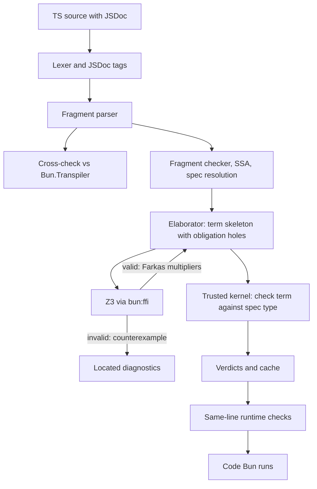

# INITIAL_MVP: dependent-type verifier for TypeScript, as a Bun plugin

This is an implementation handoff. It is written for an engineer or LLM who has not seen the design discussion. Every decision below has already been made with the project owner. Do not relitigate them; if one turns out to be impossible, stop and report it, with evidence, rather than silently changing course.

The "Verified environment facts" section records behavior that was tested experimentally on this machine (Bun 1.4.2, Linux x64, October 2026). The experiments were throwaway scripts outside the repo, so the essential code is reproduced inline here.

---

## 1. Goal

Build a build-time verifier for a small, pure subset of TypeScript. Users annotate functions with JSDoc specs (`@pre`, `@post`, `@invariant`, `@decreases`). A Bun plugin:

1. Parses each annotated function with **our own parser** (no TypeScript compiler at runtime).
2. Generates proof obligations and checks them with **Z3, loaded in-process through `bun:ffi`**.
3. For each valid obligation, asks Z3 for a **Farkas certificate** and builds a proof term.
4. Has a **trusted dependent-type kernel** check the whole function, as a term, against the dependent type derived from its spec. Nothing counts as verified until the kernel accepts it.
5. Injects **runtime checks** into the code Bun runs, editing only within existing lines so stack-trace line numbers stay exact.

The deliverable is a working MVP demo, not a production system. Correctness of the kernel and faithfulness of the extractor matter more than breadth.

### Definition of done

- A user annotates pure functions with `@pre`/`@post` and runs `bun run verify` to get kernel-certified verdicts, or `file:line:col` diagnostics with counterexamples.
- The same plugin works under `bun run`, `bun test` (preload) and `Bun.build`.
- Strict mode fails the build or import when any obligation is not kernel-certified.
- Runtime checks are injected. Production builds strip certified postconditions and internal checks, but keep exported preconditions and boundary type guards.
- Linear arithmetic, equality, array bounds and length-indexed vectors all work, as do loops, recursion and non-recursive tagged unions.
- A kernel test suite shows the kernel rejects attempts to prove `false`.
- `examples/`, `scripts/demo.ts`, a `bun test` suite and a README exist.

---

## 2. Locked decisions

| Topic | Decision |
|---|---|
| Delivery | A Bun plugin (`onLoad`), plus a `bun run verify` CLI that uses the same code. |
| Packages | **No runtime npm dependencies.** `package.json` has no `dependencies`. The only devDependencies are `typescript` and `@types/bun`, used solely by `bun run typecheck` to type-check this repo; the plugin must never import `typescript`. |
| Parser | Hand-written lexer and fragment parser. Every parse is cross-checked against Bun's own transpiler (section 6.2). |
| Solver | Z3 5.1.0 official release, loaded through `bun:ffi`. `bun run setup` downloads it into a gitignored `.z3/`; the `DEP_VERIFY_LIBZ3` environment variable overrides the path. |
| Trust | The kernel in `src/kernel/` is the only trusted component. Z3, the parser, the extractor and the elaborator are untrusted. |
| Strict meaning | Strict mode requires every obligation to be **kernel-certified**. Obligations Z3 proved but the kernel did not certify ("smt-only") fail strict mode. |
| Modes | The CLI is strict by default (`--lenient` to relax). The plugin is lenient by default and strict when `DEP_VERIFY_STRICT=1`. Lenient means: warn, and inject runtime checks for anything not certified. |
| `number` | Treated as a **safe integer**. Integer literals only; `/` is rejected; every parameter and intermediate value must provably stay within `±(2^53 - 1)`; floats are rejected. |
| Division | Only `Math.floor(e / k)` and `Math.trunc(e / k)` where `k` is a positive integer literal, encoded exactly with linear bounds. |
| Tags | `@pre`, `@post` (may mention `result`), `@invariant` and `@decreases` (on loops; `@decreases` also on recursive functions). |
| Specs | Quantifier-free. Array elements are opaque values; array guarantees are about bounds and lengths. |
| Vectors | Implicit: every `readonly T[]` is a length-indexed vector `Vec T n`, where `n` is `a.length`. Specs simply mention `a.length`. |
| Fragment | Section 4.2: `const`, local `let` mutated in loops, `if`/else, ternary, early `return`, calls to verified functions (same file or imported), `readonly T[]` with `a[i]`, `a.length`, `[...a, ...b]`, `a.slice(i, j)`, `while`/`for` loops, recursion, and non-recursive tagged unions. |
| Kernel scope | Pi, Sigma, universes, Eq, Sum, Empty, built-in `Int` with the Farkas certificate rule, built-in `Vec`, and well-founded recursion on an `Int` measure. **No user-defined inductive types.** |
| Built-ins | A small reviewed prelude maps `Math.max`, `Math.min`, `Math.abs` and constant-divisor floor/trunc division to kernel definitions (section 6.3). |
| User proofs | None in the MVP. All obligations are discharged automatically. |
| Faithfulness | Keep the original code. Cross-check parses against `Bun.Transpiler`, and differential-test each verified function against an interpreter of its kernel term. |
| Integration | Synchronous `onLoad`. Results are cached by content hash in `.dep-verify/`. |
| Production | `NODE_ENV=production` strips certified postconditions and certified internal checks. Exported preconditions and boundary type guards always stay. |
| Files | `.ts` and `.mts` only. `.tsx` is excluded. |

### Hard rules (MUST / MUST NOT)

- MUST NOT import anything outside `src/kernel/` from inside `src/kernel/`, or use Bun APIs or npm packages there. Enforce this with a test that scans the kernel's imports and its uses of the `Bun` global.
- MUST NOT add runtime dependencies. Enforce this with a test that asserts `package.json` has no `dependencies` key.
- MUST NOT execute user code during verification. Specs from imported files are read by parsing, never by importing. Differential tests run only under `bun test`.
- MUST NOT make `onLoad` async (section 3.1).
- MUST NOT insert newlines when injecting runtime checks.
- MUST NOT attempt to reconstruct Z3 proof objects. Use Farkas certificates (section 6.4).
- MUST treat any `(error ...)` in Z3 output as a failure, and `unknown` as not proven.
- MUST fail loudly, with a located error, on anything outside the fragment inside an annotated function.

---

## 3. Verified environment facts

### 3.1 Bun plugin behavior (Bun 1.4.2)

1. `onLoad` intercepts the entry file and every import that matches the filter, **including files in `node_modules`** unless the filter excludes them.
2. **A runtime plugin cannot decline a file.** Returning `undefined` raises `onLoad() expects an object returned`. (`Bun.build` does allow falling through.) The filter therefore has to be exact, and files without specs must be returned unchanged as `{ contents, loader: "ts" }`.
3. **Negative lookahead works in the filter.** Use `/^(?!.*\/node_modules\/).*\.(ts|mts)$/`.
4. **Plugin-returned contents for CommonJS files lose their exports** (the module comes back with empty exports). Never match `.js` or `.cjs`.
5. **An async `onLoad` breaks `require()`** of any intercepted file: `require() async module "…" is unsupported. use "await import()" instead`. Keep `onLoad` synchronous. Z3 through `bun:ffi` and the kernel are both synchronous, so this costs nothing.
6. `args.loader` is `undefined` in runtime plugins and `"ts"` in `Bun.build`. Always return an explicit `loader: "ts"`.
7. **Throwing inside `onLoad`:** at runtime, the import rejects with the thrown message. In `Bun.build` called with `throw: false`, the result has `success: false` and the message appears in `logs`. Without `throw: false`, expect `Bun.build` itself to throw (not tested).
8. **Source maps:** Bun honors an inline source map in plugin output only if the output is already-transpiled JavaScript starting with `// @bun`, and the map URL is exactly `data:application/json;base64,…` with no `;charset=utf-8` (that variant produces `Could not decode sourcemap … UnsupportedFormat`). Without `// @bun`, Bun re-transpiles and discards the input map. **The MVP avoids source maps entirely by editing only within existing lines**, which was tested to keep stack-trace line numbers exact; only columns shift.
9. **`bunfig.toml`:** `preload` under a `[run]` section is silently ignored. Use a top-level `preload = [...]` for `bun run`, and `[test]` with `preload = [...]` for `bun test`.
10. **`Bun.Transpiler` exposes no syntax tree.** Its methods are `scan`, `scanImports`, `transform` and `transformSync`. `scan()` returns only export and import names, and `transformSync()` strips comments, including JSDoc. Its printer does normalize parentheses, which is what the parser cross-check relies on (section 6.2).
11. `bun:ffi` can `dlopen` `libz3.so`, and FFI calls are synchronous.

### 3.2 TypeScript

- `typescript` on npm is now 7.x, the Go port. It has no in-process parser API (`ts.createSourceFile` and `ts.getJSDocTags` are gone). Its `typescript/unstable/*` IPC API is async-only in Bun, unstable, and returned stale parses in testing. **We do not use TypeScript at runtime.** It is a devDependency only so `tsc --noEmit` can type-check this repo. (Confirm early that `bun run typecheck` works with TS 7's `tsc`.)
- Bun never type-checks. Our own correctness relies on `bun run typecheck` plus tests.

### 3.3 Z3 via `bun:ffi`

- Release: `https://github.com/Z3Prover/z3/releases/download/z3-5.1.0/z3-5.1.0-x64-glibc-2.39.zip`
  - SHA-256: `f47be8d27d3230e823bf1eeede2fe0abaca55bb78d0b59974370e6689a92284a`
  - The library is at `z3-5.1.0-x64-glibc-2.39/bin/libz3.so` inside the zip (about 35 MB).
- Measured: loading the library and creating a context took 11.5 ms. Typical obligations took 0.1 to 2 ms. Finding a certificate took about 1 ms.
- `Z3_eval_smtlib2_string` returns errors **inline** as `(error "line 1 column N: …")` and **keeps going**: a following `(check-sat)` still prints `sat`. The process survives. Context state persists across calls, so wrap every query in `(push)`…`(pop)`, and reset the context after any error.
- Z3's own proof objects are not usable. For a three-line `clamp` VC the proof had about 95 steps, including 25 `rewrite` steps justified only by Z3's internal simplifier and 5 opaque arithmetic `th-lemma` steps. Do not attempt reconstruction.
- SMT-LIB's integer `div` and `mod` round differently from JS's `/` and `%`: `(-7) mod 2` is 1 in SMT-LIB, while `-7 % 2` is -1 in JS. Never emit `div` or `mod`; encode floor and trunc division by a constant with linear bounds.

### 3.4 Why `number` is a safe integer

With `number` modeled as `Int` or `Real`, `x + 1 > x` is valid. For real JS doubles it is false: Z3's counterexample is `-Infinity`, and it also fails at `2^53`. The original concept's `sqrt` example, with runtime postcondition `Math.abs(r * r - x) < 1e-9`, fails for `x = 123456789` and for 47% of random `x` in [0, 1e12). Floats are out of scope for verification.

---

## 4. User-facing surface

### 4.1 Annotations

```ts
/**
 * Optional prose description.
 * @pre lo <= hi
 * @post lo <= result && result <= hi
 */
export function clamp(x: number, lo: number, hi: number): number { ... }
```

- `@pre EXPR`: a precondition. May mention parameters.
- `@post EXPR`: a postcondition. May mention parameters and `result`.
- `@decreases EXPR`: a termination measure for a recursive function. Must be a non-negative integer expression that strictly decreases at every recursive call.
- `@invariant EXPR` and `@decreases EXPR` in a JSDoc block placed **directly before** a `while` or `for` statement: the loop invariant and the loop's termination measure.
- Multiple tags of the same kind are combined with `&&`.
- A tag may continue across lines; strip the leading `*` from continuation lines.
- An empty tag is an error.
- An `@` inside an expression would start a new JSDoc tag, so it is an error.

The spec-expression grammar is a subset of the body expression grammar:

- integer literals, identifiers, `result`, `a.length`, `a[i]`, union field access under narrowing;
- unary `-` and `!`; `+`, `-`, `*` (at least one side a literal); `Math.floor(e / k)` and `Math.trunc(e / k)`;
- `<`, `<=`, `>`, `>=`, `===`, `!==`, `&&`, `||`, ternaries, parentheses;
- calls to the prelude built-ins.

No quantifiers, no `==` or `!=`, no `≈` or other non-TypeScript tokens, and no calls to user functions inside specs in the MVP.

### 4.2 The verified fragment

A function is "verified" if its JSDoc has at least one `@pre`, `@post` or `@decreases` tag. Inside a verified function:

**Accepted types** (explicit annotations required on all parameters and the return type):

- `number`: a safe integer.
- `readonly T[]`, where `T` is `number`, a generic type parameter, or a union type alias. This is a vector indexed by its length.
- Generic type parameters `<T>`, used only as array element types.
- Non-recursive tagged unions declared as `type` aliases in the same file, or imported from another verified file. Each variant is an object type with `readonly` fields, one string-literal discriminant property shared by all variants, and other fields of accepted types.
- `boolean` only as the type of conditions. Boolean parameters, return values and `const`s are **not** in the MVP.

**Accepted statements:**

- `const x = e;`
- `let x = e;` reassigned **only inside `while` or `for` loops** of the same function, using the statements `x = e;`, `x += e;`, `x -= e;`, `x++;` or `x--;` (desugared to `x = x + e` and so on). These are statements only, never expressions.
- `if`/`else`, `return e;` (including early returns), and `switch` on a union discriminant (exhaustive, every case ends in `return`, no fallthrough).
- `while (c) { … }` and `for (let i = e; c; UPDATE) { … }` (where `UPDATE` is one of the reassignment forms above), each preceded by a JSDoc block with `@invariant` and `@decreases`.

**Accepted expressions:**

- Everything in the spec grammar.
- Calls to verified functions, in the same file or imported via a relative path.
- `[...a, ...b]`, `a.slice(i, j)`, and object literals that construct a union variant.

**Rejected,** each with a `file:line:col` error naming the construct: `any`, `unknown`, `as`, `!` non-null assertions, `/` outside the floor/trunc forms, float literals, `%`, bitwise operators, mutation of parameters or captured variables, array mutation, `throw`, `try`, `await`, `async`, generators, `this`, classes, `new`, `==` and `!=`, closures and arrow functions, recursive type aliases, calls to unverified functions, optional chaining, and spread outside array literals.

### 4.3 Diagnostics

```text
examples/fail/clampNoPre.ts:6:3: error[post]: postcondition `lo <= result && result <= hi` may not hold
  path: x >= lo, x > hi
  counterexample: x = 1, lo = 1, hi = 0
examples/fail/rejected.ts:4:21: error[fragment]: `as` casts are not allowed in verified functions
examples/pass/foo.ts:9:10: warning[uncertified]: Z3 proved this obligation but no kernel certificate was found; a runtime check was injected
```

Obligation kinds used in the bracket: `pre-call`, `post`, `index`, `slice`, `append-length`, `range`, `measure-nonneg`, `measure-decrease`, `invariant-init`, `invariant-preserve`, `fragment`, `parse`, `uncertified`, `internal`.

### 4.4 Commands and environment

- `bun run setup`: download and verify Z3 into `.z3/`.
- `bun run verify [paths…] [--lenient]`: verify files (default: `examples/pass`). Exit code 1 on any failure.
- `bun run demo`: guided walkthrough (section 10).
- `bun run test` / `bun test`, and `bun run typecheck`.
- Environment variables: `DEP_VERIFY_STRICT=1` (strict plugin), `DEP_VERIFY_LIBZ3=/path/libz3.so`, `DEP_VERIFY_NO_CACHE=1`, `NODE_ENV=production` (strip).
- If `libz3` is missing: lenient mode warns once and runtime-checks every obligation; strict mode errors out.

---

## 5. Architecture



### 5.1 Repository layout

```text
src/
  kernel/            TRUSTED. Imports only from src/kernel/. No Bun APIs, no packages.
    term.ts          Term syntax (de Bruijn indices)
    value.ts         Semantic values, closures, neutral terms, linear Int values
    eval.ts          Evaluation (normalization by evaluation, NbE)
    quote.ts         Read-back from values to normal-form terms
    conv.ts          Definitional equality (beta, eta, delta, linear Int normal forms, proof irrelevance for Le)
    check.ts         Bidirectional infer/check, universes
    builtins.ts      Built-in constants, their types and reduction rules
    farkas.ts        Integer tightening and Farkas certificate checking
    env.ts           Environment: only kernel-checked declarations; axioms flagged
    errors.ts        KernelError with structured reasons
    index.ts         Public API (section 6.1.6)
  syntax/
    lexer.ts         Whole-file tokenizer with positions
    jsdoc.ts         JSDoc block parsing into tags
    ast.ts           AST types for the fragment (with source spans)
    parser.ts        Fragment parser (annotated functions, type aliases, imports)
    print.ts         Fully parenthesized printer (for the cross-check)
    crosscheck.ts    Compare our parse against Bun.Transpiler
  extract/
    fragment.ts      Fragment typing and rejection
    ssa.ts           let + loops into local recursive functions (SSA)
    specs.ts         Resolve specs of imported verified functions by parsing
    prelude.ts       JS built-ins mapped to kernel definitions
    elaborate.ts     AST into a kernel term with obligation holes; fills holes with proofs
  vc/
    obligations.ts   Obligation records (context hypotheses, goal, kind, span)
    linear.ts        Linear normalization, tightening (mirrors kernel/farkas.ts), case splitting
    smtlib.ts        SMT-LIB printing
    z3.ts            bun:ffi binding
    certify.ts       Validity, counterexamples, Farkas multiplier search, proof-term construction
  inject/
    inject.ts        Same-line runtime check injection; production stripping
    runtime.ts       PreconditionError, PostconditionError, ObligationError, guard helpers
  difftest/
    interp.ts        Interpreter for kernel terms with proofs erased
    gen.ts           Seeded random inputs satisfying @pre
  verify.ts          Verify one file end to end; returns verdicts + diagnostics + injection plan
  cache.ts           .dep-verify/ cache
  plugin.ts          The Bun plugin (runtime + Bun.build)
  preload.ts         Registers the plugin
  cli.ts             bun run verify
scripts/
  setup-z3.ts
  demo.ts
examples/
  pass/  fail/  runtime/
test/
  kernel/  syntax/  vc/  e2e/  difftest/  hygiene.test.ts
docs/
  INITIAL_MVP.md     (this file)
README.md
bunfig.toml
package.json
tsconfig.json
```

### 5.2 Configuration files

`package.json`:

```json
{
  "name": "formver-ts",
  "version": "0.1.0",
  "type": "module",
  "private": true,
  "scripts": {
    "setup": "bun scripts/setup-z3.ts",
    "verify": "bun src/cli.ts",
    "demo": "bun scripts/demo.ts",
    "test": "bun test",
    "typecheck": "tsc --noEmit"
  },
  "devDependencies": {
    "typescript": "7.0.2",
    "@types/bun": "<pin the exact version installed>"
  }
}
```

`bunfig.toml`:

```toml
preload = ["./src/preload.ts"]

[test]
preload = ["./src/preload.ts"]
```

`tsconfig.json`: `strict: true`, `noEmit: true`, `module: "esnext"`, `moduleResolution: "bundler"`, `target: "esnext"`, `types: ["bun"]`. Include `src`, `scripts`, `test` and `examples/pass`; exclude `examples/fail` (it deliberately contains rejected constructs).

`.gitignore`: add `.z3/` and `.dep-verify/`, and confirm `node_modules/` is present.

---

## 6. Component specifications

### 6.1 Kernel (`src/kernel/`, trusted)

Reference design: David Christiansen's *Checking Dependent Types with Normalization by Evaluation* (Racket; a Haskell version also exists), and Andras Kovacs' `elaboration-zoo`. `xieyuheng/tartlet` is a TypeScript port of the tutorial but is **GPL-3.0; read it, do not copy it**.

#### 6.1.1 Terms

```ts
export type Level = number; // concrete universe levels; no level polymorphism in the MVP

export type Term =
  | { tag: "Var"; index: number }                                   // de Bruijn index
  | { tag: "Sort"; level: Level }                                   // Type level
  | { tag: "Pi"; name: string; domain: Term; body: Term }
  | { tag: "Lam"; name: string; domain: Term; body: Term }          // annotated, keeps inference simple
  | { tag: "App"; fn: Term; arg: Term }
  | { tag: "Sigma"; name: string; first: Term; second: Term }
  | { tag: "Pair"; sigma: Term; first: Term; second: Term }         // annotated with its Sigma type
  | { tag: "Fst"; pair: Term }
  | { tag: "Snd"; pair: Term }
  | { tag: "Let"; name: string; type: Term; value: Term; body: Term }
  | { tag: "Const"; name: string }                                  // global declaration
  | { tag: "IntLit"; value: bigint }
  | { tag: "Prim"; op: PrimOp; level?: Level; args: Term[] }        // fully applied built-ins
  | { tag: "Farkas"; hyps: Term[]; coeffs: bigint[] };              // : Empty, when the certificate checks
```

`name` fields are only for printing; binding is by index.

#### 6.1.2 Sorts and core rules

- `Type l : Type (l+1)`. **There is no `Type : Type`.**
- Pi: if `A : Type i` and `B : Type j`, then `Pi A B : Type (max i j)`.
- Sigma: same rule as Pi.
- Propositions live in `Type 0`. There is no separate `Prop`.
- Bidirectional checking: `infer(ctx, t)` and `check(ctx, t, ty)`. Lambdas and pairs carry annotations, so inference is always possible. `check` falls back to infer-then-convert.
- Conversion (`conv.ts`) covers beta, eta for functions and pairs, delta (unfolding `Const` definitions, except opaque ones), `Let` (zeta), and the built-in rules below.

#### 6.1.3 Built-ins (`builtins.ts`)

Logic:

- `Empty : Type 0`, with eliminator `absurd A e`.
- `Unit : Type 0`, with `tt`.
- `Sum A B`, with `inl`, `inr` and dependent `case`. Used for `||` and for tagged unions.
- `And A B` is the non-dependent Sigma, `Not A` is `A -> Empty`, and implication is Pi.
- `Eq A a b`, with `refl` and `J` (transport).

Integers:

- `Int : Type 0`, with `IntLit` (bigint) and the operations `add`, `sub`, `neg`, and `mulConst k e` (`k` a literal). Multiplication of two non-literals does not exist.
- `Le a b : Type 0` is a primitive proposition. `Lt a b` is **defined** as `Le (a + 1) b` (integers).
- `ifLe {A : Type l} a b (yes : Le a b -> A) (no : Lt b a -> A) : A`. Reduces when `a` and `b` are both literals. This is how branch conditions enter the context as hypotheses.
- `byContra a b (k : Lt b a -> Empty) : Le a b`. Sound because integers are totally ordered.
- `intEq a b (p : Le a b) (q : Le b a) : Eq Int a b`.
- `InRange x` is defined as `And (Le (-(2^53-1)) x) (Le x (2^53-1))`.

Linear normal form: values of type `Int` built from literals, `add`, `sub`, `neg` and `mulConst` evaluate to a **linear value** (a constant plus a map from atom to coefficient). An atom is any neutral `Int` value: a variable, or an opaque application such as `get Int n v i p`. Atom identity is decided by a canonical key computed from the atom's quoted normal form, **with proof arguments erased** (next item). Conversion of two `Int` values compares their linear forms. This makes `n + 0`, `0 + n` and `n` convertible, so `Vec A (n + 0)` and `Vec A n` are the same type.

`Le` conversion: `Le a b` and `Le c d` are convertible when `b - a` and `d - c` have the same linear normal form. They are the same proposition, so this is sound. It is what lets the `no` branch of `ifLe (x + 1) lo`, whose hypothesis is `Lt lo (x + 1)` (that is, `Le (lo + 1) (x + 1)`), be used where `Le lo x` is expected (section 6.3).

Proof irrelevance: proof arguments of built-ins (the bounds proof of `get`, the slice proofs, and so on) are marked irrelevant and ignored by conversion and atom keys. This is sound because `Le` is a mere proposition. Implement it with a per-`PrimOp` mask of irrelevant argument positions.

Vectors:

- `Vec (A : Type 0) (n : Int) : Type 0`.
- `len A n v` reduces to `n`.
- `vecBounds A n v : And (Le 0 n) (Le n 4294967295)`, which builds in JS's array length limit.
- `get A n v i (p : And (Le 0 i) (Lt i n)) : A`.
- `append A n m (u : Vec A n) (w : Vec A m) (p : Le (n + m) 4294967295) : Vec A (n + m)`.
- `slice A n v i j (p : And (Le 0 i) (And (Le i j) (Le j n))) : Vec A (j - i)`.
- `castVec A n m (e : Eq Int n m) v : Vec A m` (or derive it from `J`).
- Arrays crossing a function boundary use `Sigma (n : Int). Vec A n`.

Recursion:

```text
fixWf : (A : Type 0) -> (B : A -> Type l) -> (m : A -> Int)
      -> (step : (x : A) -> Le 0 (m x)
                 -> ((y : A) -> Le 0 (m y) -> Lt (m y) (m x) -> B y)
                 -> B x)
      -> (x : A) -> Le 0 (m x) -> B x
```

`fixWf` is **opaque**: it has no reduction rule, so conversion always terminates. Callers never need to unfold recursive functions, because they use the function's type.

Division by a constant `k > 0` (literal):

- `divFloor e k`, with primitive lemma `divFloorSpec e k : And (Le (k*q) e) (Le e (k*q + k - 1))`, where `q = divFloor e k`.
- `divTrunc e k`, with primitive lemmas for `e >= 0` (same as floor) and `e < 0` (`k*q - k + 1 <= e <= k*q`).
- Both reduce on literals.

#### 6.1.4 The Farkas rule (`farkas.ts`)

`Farkas { hyps, coeffs } : Empty`, when:

1. Each `hyps[i]` infers a type whose weak head normal form is `Le s t` (`Lt` unfolds to `Le`).
2. Each hypothesis becomes a row `c · atoms <= b` from the linear form of `s - t`.
3. **Integer tightening** of each row: let `g` be the GCD of the nonzero coefficients; divide every coefficient by `g` and set `b := floor(b / g)`. Sound because atoms are integer-valued. Strict inequalities are already handled because `Lt a b` is defined as `Le (a + 1) b`.
4. `coeffs.length === hyps.length`, and every coefficient is `>= 0n`.
5. For every atom, `Σ coeffs[i] * c_i[atom] === 0n`.
6. `Σ coeffs[i] * b_i < 0n`.

All arithmetic uses `bigint`. The untrusted `src/vc/linear.ts` must implement **the same** tightening, deliberately duplicated because the kernel cannot import it, so that the multipliers it finds match the kernel's rows.

Reference checker (from the experiments; adapt it into the kernel):

```ts
type Row = { a: Record<string, bigint>; b: bigint }; // a · x <= b, after tightening

function checkCertificate(rows: Row[], lambda: bigint[]): boolean {
  if (lambda.length !== rows.length || lambda.some((l) => l < 0n)) return false;
  const total: Record<string, bigint> = {};
  let b = 0n;
  rows.forEach((r, k) => {
    for (const [v, c] of Object.entries(r.a)) total[v] = (total[v] ?? 0n) + lambda[k]! * c;
    b += lambda[k]! * r.b;
  });
  return Object.values(total).every((c) => c === 0n) && b < 0n;
}
```

#### 6.1.5 Environment (`env.ts`)

- `Env` maps names to declarations: `{ kind: "def", type, value, opaque? } | { kind: "axiom", type, reason } | { kind: "external", type, source: { file, hash } }`.
- `addDecl` type-checks the declaration and inserts it only if the check passes. There is no other way to insert.
- `axiom` is reserved; the MVP should end with **zero** axioms (the prelude uses definitions, section 6.3).
- `external` declarations hold imported functions' spec types, so a file can be checked independently. The strict CLI then confirms that every `external` declaration was certified in its own file, with a matching content hash.

#### 6.1.6 Public API (`index.ts`)

```ts
export function emptyEnv(): Env;                                   // built-ins preloaded
export function addDecl(env: Env, decl: Decl): Result<Env, KernelError>;
export function inferType(env: Env, term: Term): Result<Term, KernelError>;
export function checkType(env: Env, term: Term, type: Term): Result<void, KernelError>;
export function isConvertible(env: Env, a: Term, b: Term): boolean;
export function erase(term: Term): ErasedTerm;                     // drop proofs and types, for difftest
```

### 6.2 Syntax (`src/syntax/`, untrusted)

- **Lexer** (`lexer.ts`): tokenizes the **whole file** with `{ line, col, offset }` spans. It must handle line and block comments (keeping JSDoc blocks as tokens), string literals, template literals with nested `${…}`, regex literals versus `/` (decide from the previous significant token, esbuild-style), numeric literals (flag floats, hex and bigint), and identifiers. Only annotated functions, the type aliases they use, and `import` declarations are parsed fully. Everything else is skipped by matching braces at the token level.
- **JSDoc** (`jsdoc.ts`): splits a `/** … */` block into tags, strips leading `*` from continuation lines, and joins multi-line tags. Errors: an empty tag, an unknown tag adjacent to spec tags (`@foo` right after `@pre`), and unparseable expressions.
- **Parser** (`parser.ts`): recursive descent with precedence climbing, matching JavaScript precedence and associativity for the accepted operators. Produces AST nodes with spans. Anything outside the grammar is a `parse` or `fragment` error at its span.
- **Cross-check** (`crosscheck.ts`): for every annotated function, print our AST with every subexpression parenthesized (`print.ts`), then compare `new Bun.Transpiler({ loader: "ts" }).transformSync(...)` of the original function text with that of our printout. Bun's printer drops redundant parentheses, so identical output means identical parses. On any mismatch, reject the function with an `internal` diagnostic. In the experiments, this check passed correct parses of `clamp` and a bounds condition, and caught a deliberately wrong parse of `a - b - c` as `a - (b - c)`.

```ts
const bun = new Bun.Transpiler({ loader: "ts" });
const norm = (code: string) => bun.transformSync(code).trim();
export function sameParse(originalText: string, ourParenthesizedText: string): boolean {
  return norm(originalText) === norm(ourParenthesizedText);
}
```

Statement-level printing must produce text Bun normalizes identically: same statement order, braces, and `return`/`if` forms. Write tests for each statement kind.

### 6.3 Extraction (`src/extract/`, untrusted)

- **Fragment checker** (`fragment.ts`): resolves names, checks the explicit types from section 4.2, performs narrowing for union discriminants (`if`, `switch`, ternary, `&&`), and rejects everything else with a location.
- **Type mapping:**
  - A `number` parameter `x` becomes `(x : Int) -> InRange x -> …`.
  - A `readonly T[]` parameter `a` becomes `(n_a : Int) -> (a : Vec T n_a) -> …`, with `a.length` mapped to `len T n_a a`, which reduces to `n_a`. `readonly number[]` elements get an `InRange` fact at each read; the runtime boundary guard checks every element, so `number[]` guards are O(n).
  - Generics become `(T : Type 0) -> …`.
  - A returned array becomes `Sigma (m : Int). Vec T m`; `result.length` maps to the first component.
  - A union alias becomes nested `Sum` of `Sigma` records, in variant declaration order.
- **SSA** (`ssa.ts`): local `let` variables and loops become local recursive functions over a tuple of the loop-carried variables, built with `fixWf`. The loop function computes **the rest of the function**: `loop(s) = if cond(s) then body(s, continue = loop(s'), return = ret) else rest(s)`. Its precondition is the invariant, and its measure is `@decreases`. Early `return`s inside the loop become direct returns.
- **Spec resolution** (`specs.ts`): for each relative import used by a verified function, read and parse the imported `.ts` file (never import it) and extract the callee's signature and spec. Specs are enough to build an `external` declaration, so import cycles are harmless.
- **Prelude** (`prelude.ts`): maps JS built-ins to **kernel definitions**, not axioms. `Math.max(a, b)` maps to `ifLe a b (_ => b) (_ => a)`, `Math.min` similarly, and `Math.abs(x)` to `ifLe 0 x (_ => x) (_ => -x)`. `Math.floor(e / k)` maps to `divFloor e k`, and `Math.trunc(e / k)` to `divTrunc e k`. The trusted assumption is only that these JS built-ins behave like their definitions on safe integers, so keep the prelude small and documented.
- **Elaborator** (`elaborate.ts`): turns the function's spec into its kernel type, and the body into a kernel term with **holes**. Each hole records its context (hypotheses in scope as de Bruijn variables), its goal, its obligation kind and its source span. After `src/vc/certify.ts` produces proofs, the elaborator fills the holes and asks the kernel to check the complete function.

Spec type for `clamp`:

```text
clamp : (x : Int) -> InRange x -> (lo : Int) -> InRange lo -> (hi : Int) -> InRange hi
      -> Le lo hi
      -> Sigma (r : Int). And (InRange r) (And (Le lo r) (Le r hi))
```

Term skeleton (`?k` are holes; branch conditions arrive as hypotheses through `ifLe`):

```text
λ x rx lo rlo hi rhi pre.
  ifLe (x + 1) lo
    (h1 : Le (x + 1) lo) => ⟨lo, ⟨rlo, ⟨?1 : Le lo lo, pre⟩⟩⟩
    (h1' : Lt lo (x + 1)) =>
      ifLe (hi + 1) x
        (h2 : Le (hi + 1) x)      => ⟨hi, ⟨rhi, ⟨?2 : Le lo hi, ?3 : Le hi hi⟩⟩⟩
        (h2' : Lt x (hi + 1))     => ⟨x, ⟨rx, ⟨h1', h2'⟩⟩⟩
```

`h1'` unfolds to `Le (lo + 1) (x + 1)` and `h2'` to `Le (x + 1) (hi + 1)`. By the `Le` conversion rule in section 6.1.3, they are accepted where `Le lo x` and `Le x hi` are expected. `?2` is filled directly with `pre`; `?1` and `?3` go through `certify`.

Where obligations arise:

- **post:** at each `return`.
- **pre-call:** at each call to a verified function or built-in with preconditions.
- **index:** at each `a[i]`.
- **slice:** at each `slice`.
- **append-length:** at each array spread.
- **range:** after each arithmetic operation.
- **measure-nonneg** and **measure-decrease:** at recursive calls and loop back-edges.
- **invariant-init** and **invariant-preserve:** for loops.

Holes whose goal is literally a hypothesis already in scope are filled directly. Every other hole goes through `certify`.

### 6.4 Obligations and Z3 (`src/vc/`, untrusted)

- **`linear.ts`:** normalizes hypotheses and goals into linear rows over atoms, applies the same tightening as the kernel, and expands into one case per path:
  - `!==` in a hypothesis gives two cases (`<` or `>`);
  - `||` in a hypothesis is a `Sum`, giving one case per side;
  - `&&` in a goal is proven component-wise;
  - `||` in a goal is proven by `ifLe` on one disjunct, assuming its negation in the other branch;
  - an `===` goal is proven as two `Le` goals combined with `intEq`.
- **`smtlib.ts`:** prints obligations as SMT-LIB over `Int`. Atoms become declared constants. **Never emit `div` or `mod`.**
- **`z3.ts`:** the binding below, verified in the experiments. Create one context per process, lazily. Wrap every query in `(push)`/`(pop)`. If the output contains `(error`, record a failure and recreate the context. Set a per-query timeout and treat `unknown` as not proven. Confirm the exact timeout mechanism works, for example `(set-option :timeout 5000)` or `Z3_global_param_set`.

```ts
import { dlopen, FFIType, ptr } from "bun:ffi";

export function openZ3(libPath: string) {
  const z3 = dlopen(libPath, {
    Z3_get_full_version: { args: [], returns: FFIType.cstring },
    Z3_mk_config: { args: [], returns: FFIType.ptr },
    Z3_del_config: { args: [FFIType.ptr], returns: FFIType.void },
    Z3_mk_context: { args: [FFIType.ptr], returns: FFIType.ptr },
    Z3_del_context: { args: [FFIType.ptr], returns: FFIType.void },
    Z3_set_error_handler: { args: [FFIType.ptr, FFIType.ptr], returns: FFIType.void },
    Z3_eval_smtlib2_string: { args: [FFIType.ptr, FFIType.ptr], returns: FFIType.cstring },
  });
  const cfg = z3.symbols.Z3_mk_config();
  const ctx = z3.symbols.Z3_mk_context(cfg);
  z3.symbols.Z3_del_config(cfg);
  z3.symbols.Z3_set_error_handler(ctx, null); // errors come back as text instead of aborting
  return {
    version: () => String(z3.symbols.Z3_get_full_version()),
    eval(script: string): string {
      const buf = Buffer.from(script + "\0", "utf8");
      return String(z3.symbols.Z3_eval_smtlib2_string(ctx, ptr(buf))).trim();
    },
    close: () => z3.symbols.Z3_del_context(ctx),
  };
}
```

- **`certify.ts`:** for each hole, and for each case of the path split:
  1. **Validity:** assert the hypotheses and the negated goal, then `(check-sat)`. `unsat` means valid. `sat` means invalid: run `(get-model)` and produce a counterexample over the user's variable names. `unknown` or error means not proven.
  2. **Certificate:** take the tightened rows (hypotheses plus the tightened negated goal). Ask Z3 for non-negative **integer** multipliers `λ` with `Σ λ_k a_k = 0` per atom and `Σ λ_k b_k < 0`. Integer multipliers suffice, because any rational certificate can be scaled to integers.
  3. **Proof term:** case splits (`case` and `ifLe`) whose leaves are `byContra a b (h => Farkas [hyps…, h] [λ…])`, or `absurd (Farkas …)` when the hypotheses alone are contradictory.
  4. If no certificate exists (an integer fact that needs more than per-row tightening), the obligation is **smt-only**.

Certificate search (verified in the experiments; it found `λ = [0, 1, 1]` for the bounds VC in 1.3 ms):

```ts
function findCertificate(rows: Row[], smt: (s: string) => string): bigint[] | null {
  const vars = [...new Set(rows.flatMap((r) => Object.keys(r.a)))];
  const ls = rows.map((_, k) => `l${k}`);
  const lit = (n: bigint) => (n < 0n ? `(- ${-n})` : `${n}`);
  const sum = (coef: (r: Row) => bigint) => `(+ 0 ${rows.map((r, k) => `(* ${lit(coef(r))} l${k})`).join(" ")})`;
  const script = [
    "(push)",
    ...ls.map((l) => `(declare-const ${l} Int) (assert (>= ${l} 0))`),
    ...vars.map((v) => `(assert (= ${sum((r) => r.a[v] ?? 0n)} 0))`),
    `(assert (< ${sum((r) => r.b)} 0))`,
    `(check-sat) (get-value (${ls.join(" ")}))`,
    "(pop)",
  ].join(" ");
  const out = smt(script);
  if (out.includes("(error") || !out.startsWith("sat")) return null;
  return ls.map((l) => BigInt(out.match(new RegExp(`\\(${l} (\\d+)\\)`))![1]!));
}
```

### 6.5 Verification driver, cache and modes (`src/verify.ts`, `src/cache.ts`)

`verify(path, source, options)` runs, in order: lex, find annotated functions, parse, cross-check, fragment check, SSA, spec resolution, elaborate, certify, kernel check. It returns per-function verdicts (`certified | smt-only | failed | rejected`), per-obligation statuses, diagnostics, and an injection plan.

- A function is **certified** only if the kernel accepted its complete term.
- A function with any smt-only obligation is not added to the kernel environment. In lenient mode, its spec may still be used by callers, but those callers are marked as depending on an uncertified function.
- **Cache:** `.dep-verify/cache/<sha256>.json`. The key hashes the verifier version, the file contents, and the contents of every imported file whose specs were used. Use the built-in `Bun.CryptoHasher`. `DEP_VERIFY_NO_CACHE=1` bypasses the cache.

### 6.6 Runtime check injection (`src/inject/`)

All edits stay **within existing lines**; never insert `\n`.

- **Runtime import:** prepend `import * as __dv from "<absolute path to src/inject/runtime.ts>";` to line 1, or to line 2 if line 1 is a `#!` shebang.
- **Function entry:** after the opening `{` of each verified function, on the same line, insert:
  1. boundary guards for exported functions (`__dv.guardInt("clamp", "x", x)`, `__dv.guardIntArray(...)` (every element), `__dv.guardArray(...)`, `__dv.guardUnion(...)`);
  2. `@pre` checks: `if (!(lo <= hi)) throw new __dv.PreconditionError("clamp", "lo <= hi", { x, lo, hi });`.
- **Returns:** rewrite `return e;` to `return ((result) => { if (!(POST)) throw new __dv.PostconditionError("clamp", "POST", { x, lo, hi, result }); return result; })(e);` on the same line. Spec expressions are valid JS as written.
- **Uncertified internal obligations** (lenient mode, or certification failed): wrap the expression in place, for example `a[__dv.checkIndex(a, i, "file:line:col")]`, `__dv.checkRange(x + y, "loc")`, `__dv.checkSlice(...)`, and loop-head invariant and measure checks.
- **Production** (`NODE_ENV=production`): drop certified postconditions and certified internal checks. **Always keep** boundary guards and preconditions of exported functions. Keep preconditions of non-exported functions that are called from unverified code in the same file. Keep every check tied to an uncertified obligation.
- **`runtime.ts`:** exports the error classes (each carrying function name, spec text, argument snapshot and location) and the guard and check helpers. It has no dependencies.

### 6.7 Plugin, preload and CLI

`src/plugin.ts`, **synchronous**:

```ts
import type { BunPlugin } from "bun";
import { readFileSync } from "node:fs";

export const depVerifyPlugin: BunPlugin = {
  name: "dep-verify",
  setup(builder) {
    builder.onLoad({ filter: /^(?!.*\/node_modules\/).*\.(ts|mts)$/ }, (args) => {
      const source = readFileSync(args.path, "utf8");
      if (isOwnSource(args.path) || !/@(pre|post|decreases)\b/.test(source)) {
        return { contents: source, loader: "ts" };
      }
      const result = verifyCached(args.path, source, { strict: process.env.DEP_VERIFY_STRICT === "1" });
      if (!result.ok && result.strict) throw new Error(formatDiagnostics(result));
      if (result.diagnostics.length) console.warn(formatDiagnostics(result));
      return { contents: inject(source, result.plan, { production: process.env.NODE_ENV === "production" }), loader: "ts" };
    });
  },
};
```

- `isOwnSource` skips everything under this repo's `src/`. Our own files mention `@pre` in strings and would otherwise be scanned needlessly.
- The same plugin object is passed to `Bun.build({ plugins: [depVerifyPlugin] })`.
- `src/preload.ts`: `import { plugin } from "bun"; plugin(depVerifyPlugin);`.
- `src/cli.ts`: verifies the given files or directories, strict unless `--lenient`. It prints diagnostics and a summary table (functions certified / smt-only / failed / rejected; axioms used: must be 0), checks that every `external` declaration was certified, and exits non-zero on failure. It does not inject or run anything.

### 6.8 Differential testing (`src/difftest/`)

- `interp.ts` evaluates `erase(term)`. `fixWf` becomes real recursion, vectors become JS arrays, and `Sum` and `Sigma` become tagged objects.
- `gen.ts` uses a seeded PRNG (no packages). It generates integers from `[-1000, 1000]` plus edge values (0, ±1, ±(2^53 - 1) where `@pre` allows), arrays of length 0 to 8, and union variants. Inputs that violate `@pre` are rejected; give up after a bounded number of attempts.
- For every passing example function, run 200 inputs: call the original exported function and the interpreter on the same input, and assert the results are deeply equal and that `@post` holds.

---

## 7. Milestones (do them in order)

Each milestone ends with `bun test` and `bun run typecheck` both passing, and one commit.

1. **Setup.** Add `package.json`, `bunfig.toml`, `tsconfig.json` and the `.gitignore` entries. Write `scripts/setup-z3.ts`: download the pinned zip, verify its SHA-256, extract `bin/libz3.so` into `.z3/` with `unzip` (clear error if missing), and print the Z3 version through FFI. Add `test/hygiene.test.ts` (no `dependencies`; kernel imports stay inside `src/kernel/`).
   *Acceptance:* `bun run setup` prints `Z3 5.1.0.0`; the hygiene tests pass.
2. **Kernel core.** Terms, values, eval, quote, conversion, bidirectional checker, universes, Pi, Sigma, Let, Const, Eq, Sum, Empty, Unit, env and errors.
   *Acceptance:* tests for identity, constant function, composition, dependent pairs, Church numerals, `J` transport, beta, eta and delta conversion, rejecting `Type 0 : Type 0` and `Type l : Type l`, and ill-typed applications, lambdas and pairs.
3. **Kernel built-ins.** `Int` with linear normal forms, `Le`/`Lt`, `ifLe`, `byContra`, `intEq`, `InRange`, the Farkas rule with tightening, proof-irrelevance masks, `Vec` operations and bounds, `fixWf`, `divFloor`/`divTrunc`.
   *Acceptance:* the soundness tests in section 9.1, plus positive tests (`Vec A (n + 0)` converts to `Vec A n`; append lengths; certificates for the bounds VC and a `clamp` path).
4. **Syntax.** Lexer, JSDoc parsing, parser, printer and cross-check.
   *Acceptance:* section 9.2 tests; every `examples/` file lexes; every annotated function in `examples/pass` parses and passes the cross-check.
5. **Extraction.** Fragment checker, type mapping, SSA and loops, spec resolution, prelude.
   *Acceptance:* every `examples/fail/rejected.ts` construct gives the expected located error; loops and recursion produce the expected structure (tested on the AST level).
6. **Z3 and obligations.** Binding, SMT-LIB printer, linear normalization and case splitting, validity checks, counterexamples, certificate search.
   *Acceptance:* section 9.3 tests.
7. **Elaboration.** Holes, proof construction and kernel admission.
   *Acceptance:* every function in `examples/pass` is kernel-certified with zero axioms; every `examples/fail` function gets its expected diagnostic kind and location.
8. **Injection, plugin and CLI.** Same-line injection, runtime module, production stripping, cache, plugin, preload and CLI.
   *Acceptance:* section 9.4 tests; `bun run verify` is green on `examples/pass` and red on `examples/fail`; `bun run examples/runtime/main.ts` shows a `PreconditionError` pointing at the right line.
9. **Differential testing.**
   *Acceptance:* difftest passes for every function in `examples/pass`. Add a test with a deliberately unfaithful elaboration (for example, swapping `<` for `<=` in one branch) and show difftest catches it.
10. **Examples, demo and docs.** Write the README (usage, fragment rules, design rationale, trust story, known limits) and `scripts/demo.ts`.
    *Acceptance:* `bun run demo` runs start to finish on a fresh clone after `bun install && bun run setup`.

---

## 8. Examples

Write these files exactly (adjust only if the grammar requires it, and note any changes in the README).

`examples/pass/clamp.ts`:

```ts
/**
 * @pre lo <= hi
 * @post lo <= result && result <= hi
 */
export function clamp(x: number, lo: number, hi: number): number {
  if (x < lo) return lo;
  if (x > hi) return hi;
  return x;
}
```

`examples/pass/abs.ts`:

```ts
/**
 * @post result >= 0
 * @post result === x || result === -x
 */
export function abs(x: number): number {
  return x < 0 ? -x : x;
}
```

`examples/pass/safeGet.ts`:

```ts
/**
 * @pre 0 <= i && i < a.length
 */
export function safeGet<T>(a: readonly T[], i: number): T {
  return a[i];
}
```

`examples/pass/concat.ts` and `examples/pass/take.ts`:

```ts
/**
 * @pre a.length + b.length <= 4294967295
 * @post result.length === a.length + b.length
 */
export function concat<T>(a: readonly T[], b: readonly T[]): readonly T[] {
  return [...a, ...b];
}
```

```ts
/**
 * @pre 0 <= n && n <= a.length
 * @post result.length === n
 */
export function take<T>(a: readonly T[], n: number): readonly T[] {
  return a.slice(0, n);
}
```

`examples/pass/binarySearch.ts` (only index safety is specified; elements are opaque):

```ts
/**
 * @post -1 <= result && result < a.length
 */
export function binarySearch(a: readonly number[], target: number): number {
  let lo = 0;
  let hi = a.length;
  /**
   * @invariant 0 <= lo && lo <= hi && hi <= a.length
   * @decreases hi - lo
   */
  while (lo < hi) {
    const mid = Math.floor((lo + hi) / 2);
    if (a[mid] === target) return mid;
    if (a[mid] < target) {
      lo = mid + 1;
    } else {
      hi = mid;
    }
  }
  return -1;
}
```

The midpoint obligations `lo <= mid < hi` have certificates with per-row tightening. The negated goals `mid >= hi` and `mid <= lo - 1` are both contradictory over the rationals, given `divFloorSpec` and `lo + 1 <= hi`.

`examples/pass/sumTo.ts`:

```ts
/**
 * @pre 0 <= n && n <= 1000000
 * @post 0 <= result && result <= n * 1000000
 * @decreases n
 */
export function sumTo(n: number): number {
  if (n === 0) return 0;
  return n + sumTo(n - 1);
}
```

`examples/pass/shape.ts`:

```ts
type Shape =
  | { readonly kind: "square"; readonly side: number }
  | { readonly kind: "rect"; readonly w: number; readonly h: number };

/**
 * @pre s.kind === "square" ? 0 <= s.side && s.side <= 1000000 : 0 <= s.w && s.w <= 1000000 && 0 <= s.h && s.h <= 1000000
 * @post result >= 0
 */
export function perimeter(s: Shape): number {
  switch (s.kind) {
    case "square":
      return 4 * s.side;
    case "rect":
      return 2 * (s.w + s.h);
  }
}
```

`examples/pass/useClamp.ts`:

```ts
import { clamp } from "./clamp";

/**
 * @post 0 <= result && result <= 100
 */
export function percent(p: number): number {
  return clamp(p, 0, 100);
}
```

`examples/fail/`. Expected diagnostic kinds are in comments. **Do not assert exact counterexample values in tests.** Z3 may pick different ones, so evaluate the counterexample against the spec instead.

- `clampNoPre.ts`: `clamp` without `@pre`, giving `error[post]` with a counterexample such as `lo = 1, hi = 0, x = 1`.
- `offByOne.ts`: `@pre 0 <= i && i <= a.length` with `return a[i];`, giving `error[index]` with `i = a.length`.
- `overflow.ts`: `@post result === x + y` with `return x + y;` and no bounds, giving `error[range]`.
- `noDecrease.ts`: `@pre 0 <= n`, `@decreases n`, and body `if (n === 0) return 0; return spin(n);`, giving `error[measure-decrease]`.
- `rejected.ts`: one small annotated function per construct (`any`, `as`, parameter mutation, `/`, `throw`, float literal, `this`, `%`), each giving `error[fragment]` at the construct's location.

`examples/runtime/main.ts` (unverified caller):

```ts
import { safeGet } from "../pass/safeGet";

console.log(safeGet([10, 20, 30], 1));
console.log(safeGet([10, 20, 30], 5)); // PreconditionError, reported at safeGet.ts's function line
```

---

## 9. Test plan (`bun test`)

### 9.1 Kernel soundness: each attempt to prove `false` must be rejected

- A forged Farkas certificate, with the right shape but `Σ λ b >= 0`.
- A certificate with a negative multiplier.
- Tightening edge cases: a certificate for `2x <= 1` and `2x >= 1` **must be accepted** (contradictory after tightening), while `2x <= 2` and `2x >= 2` (satisfied by `x = 1`) must have no accepted certificate.
- `Farkas` with a hypothesis whose type is not `Le` (for example, an `Eq`).
- `get` without a bounds proof, and with a proof of the wrong bound.
- A `fixWf` step that calls the induction hypothesis without a decrease proof, or with `Le (m y) (m x)` instead of `Lt`.
- Conversion must **not** identify `Vec A n` with `Vec A (n + 1)`, `2 * x` with `x + 1`, or `Le a b` with `Le a (b + 1)`.
- `Type 0 : Type 0` and a Girard-style self-application through `Type`.
- An `ifLe` with swapped branch hypothesis types.
- `byContra` applied with a hypothesis of the wrong direction.
- A term in which conversion of a `fixWf` application would need unfolding (it must not unfold).

### 9.2 Syntax

- Lexer: regex versus division (`a / b / c`, `x = /re/g`), template literals with nested braces, comments containing `*/`-like text, strings containing `@pre`.
- JSDoc: multi-line tags, an empty tag (error), `@` inside an expression (error), braces kept as written, unknown tags.
- Parser: precedence and associativity of every accepted operator, nested ternaries, `switch` forms.
- Cross-check: agreement on all examples, and detection of a deliberately broken parser (inject a precedence bug in a test double).

### 9.3 Obligations and Z3

- `clamp` with its precondition is valid; without it, invalid with a counterexample that actually violates the spec.
- The bounds VC (`0 <= i < n` implies `i + 1 <= n`) is valid.
- Certificates are found and accepted by the kernel's `farkas.ts` (call the kernel API from the test). Forged certificates are rejected.
- Malformed SMT-LIB yields a failure, never a verdict, and the context is reset afterwards.
- Timeout or `unknown` yields "not proven".

### 9.4 End to end

- `bun run verify examples/pass` exits 0 with every function certified and zero axioms.
- `bun run verify examples/fail` exits 1 with each expected diagnostic kind and location.
- Plugin under `bun run` (run as a subprocess): `examples/runtime/main.ts` throws `PreconditionError`, and the stack trace's first frame is `safeGet.ts` at the function's original line.
- Plugin in strict mode (`DEP_VERIFY_STRICT=1`): importing a failing example rejects with the diagnostic text.
- `Bun.build` with the plugin: `success: true` for `examples/pass`. With `NODE_ENV=production`, the output contains the exported precondition checks and guards but not the certified postcondition checks. With `throw: false`, the build fails for a failing example, with diagnostics in `logs`.
- Cache: a second run hits the cache, and editing an imported file's spec invalidates its dependents.
- Difftest (section 6.8) for every passing example, plus the unfaithful-elaboration test.

---

## 10. Demo (`scripts/demo.ts`)

A guided terminal walkthrough with short headings:

1. Show `examples/pass/clamp.ts`, run verification, show "certified by kernel, 0 axioms" and the number of obligations and certificates.
2. Show `examples/fail/clampNoPre.ts` and its diagnostic with the counterexample.
3. Run `binarySearch`, `sumTo`, `shape` and `useClamp` (all certified), and print the summary table.
4. Run `examples/fail/` and show each diagnostic kind.
5. Run `examples/runtime/main.ts` under the preload plugin, showing the `PreconditionError` with the correct line.
6. Build `examples/pass` with `Bun.build` and `NODE_ENV=production`; show which checks remain (the exported precondition) and which were stripped.
7. Run the kernel's prove-`false` test cases and show each rejection reason.

---

## 11. Known limits (put these in the README)

- Integer facts that have no Farkas certificate after per-row tightening (they need cutting planes or branch-and-bound proofs) are smt-only: they fail strict mode and get runtime checks in lenient mode.
- There is no congruence reasoning about array elements: `i === j` does not let the kernel conclude `a[i] === a[j]`.
- Specs are quantifier-free; there are no claims about all elements of an array.
- Recursive data types (lists, trees) are unsupported; tagged unions must be non-recursive.
- `number` means a safe integer; floats are not verifiable.
- `boolean` appears only as a condition, not as a parameter, return or `const` type.
- Exported functions always keep precondition checks and boundary guards, because their callers are unknown and TypeScript types are erased at runtime. Boundary guards on `readonly number[]` are O(n).
- The trusted base is the kernel, plus the prelude's claim that `Math.max`, `Math.min`, `Math.abs`, `Math.floor` and `Math.trunc` behave like their kernel definitions on safe integers, plus the faithfulness of our parse (checked against Bun) and elaboration (differential-tested, not proven).
- Bundled Z3 setup is Linux x64 only; other platforms set `DEP_VERIFY_LIBZ3`.
- `.tsx` files are not processed.
- `bun:ffi` is marked experimental by Bun, and a native crash in Z3 would take the process down.

---

## 12. Pitfalls checklist

- Do not use `typescript` at runtime; Bun gives no syntax tree, so we parse ourselves.
- Keep `onLoad` synchronous, return `{ contents, loader: "ts" }` for every matched file, and never match `.js` or `.cjs`.
- Put `preload` at the top level of `bunfig.toml` and under `[test]`, never under `[run]`.
- Never insert newlines when injecting; handle a `#!` first line.
- Z3 context state persists: always `(push)`/`(pop)`, check for `(error`, and recreate the context after errors.
- Z3 counterexamples vary between runs and versions; tests must evaluate them, not compare literal values.
- The kernel's tightening and `src/vc/linear.ts` must match exactly; test them against each other.
- Atom keys in linear forms must be canonical and must ignore proof arguments.
- Never give `fixWf` a reduction rule.
- `Lt a b` is `Le (a + 1) b`; that definition is what makes strict inequalities work with integer tightening.
- `readonly number[]` elements are safe integers only because exported functions guard every element; keep that guard.
- The plugin must skip this repo's own `src/`.

---

## 13. References

- Bun plugins: https://bun.sh/docs/runtime/plugins
- `bun:ffi`: https://bun.sh/docs/api/ffi
- Z3 C API: https://z3prover.github.io/api/html/group__capi.html
- Z3 releases: https://github.com/Z3Prover/z3/releases
- David Christiansen, *Checking Dependent Types with Normalization by Evaluation: A Tutorial*: https://davidchristiansen.dk/tutorials/nbe/ (Haskell version: https://davidchristiansen.dk/tutorials/implementing-types-hs.pdf)
- Andras Kovacs, `elaboration-zoo`: https://github.com/AndrasKovacs/elaboration-zoo
- Vekris, Cosman and Jhala, *Refinement Types for TypeScript* (PLDI 2016), code at https://github.com/UCSD-PL/refscript
- Farkas' lemma (certificates of infeasibility for linear inequalities) and the Omega test's normalization rules (GCD tightening) for background on section 6.1.4.
